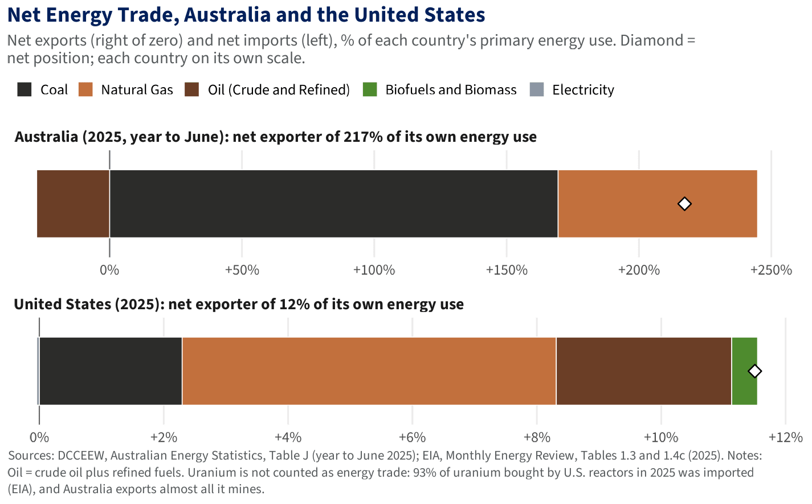
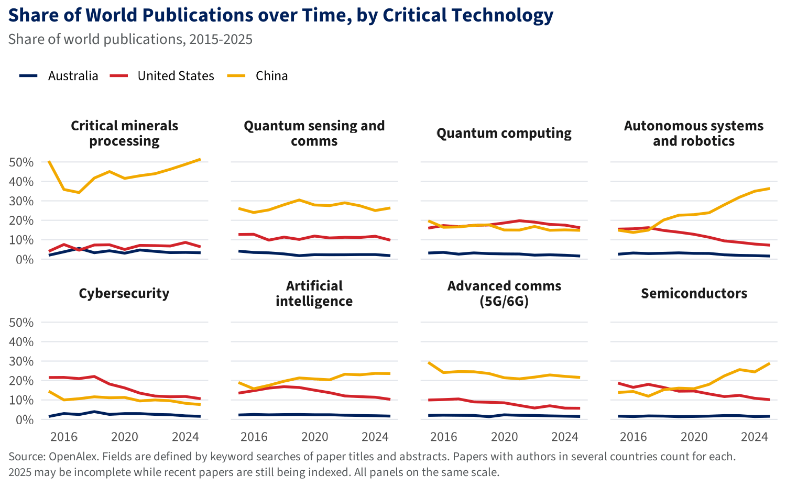

# Home {scrolling="true"}

::: {.card .ov-card}
```{r}
#| echo: false
#| output: asis
# Trial redesign of the Overview page. Headline numbers are read from the
# CSVs the 1a-1j scripts write, so they update with each quarterly refresh.
# A number whose file is missing shows as "n/a" instead of stopping the render.
suppressPackageStartupMessages({ library(readr); library(dplyr) })

safely_num <- function(expr) tryCatch(expr, error = function(e) NULL)

# Quarterly edition this render belongs to (release dates in editions/release_dates.csv)
if (Sys.getenv("DASHBOARD_DIR") == "") Sys.setenv(DASHBOARD_DIR = normalizePath(getwd(), winslash = "/"))
source("3. Editions.R")
edition <- edition_for()
fmt_money <- function(bn, sym = "A$") {
  if (is.null(bn) || length(bn) == 0 || is.na(bn)) return("n/a")
  if (bn >= 1000) sprintf("%s%.2f<small>tn</small>", sym, bn / 1000) else sprintf("%s%.1f<small>bn</small>", sym, bn)
}
# Both currencies in one element; the A$/US$ toggle swaps them
money <- function(aud_bn, usd_bn) sprintf(
  '<span data-aud-text="%s" data-usd-text="%s">%s</span>',
  htmltools::htmlEscape(fmt_money(aud_bn, "A$"), attribute = TRUE),
  htmltools::htmlEscape(fmt_money(usd_bn, "US$"), attribute = TRUE),
  fmt_money(aud_bn, "A$"))
ordinal <- function(n) paste0(n, if (n %% 100 %in% 11:13) "th" else
  switch(as.character(n %% 10), "1" = "st", "2" = "nd", "3" = "rd", "th"))
# "the largest" rather than "the 1st-largest"
largest <- function(n) if (isTRUE(n == 1)) "largest" else paste0(ordinal(n), "-largest")

# Investment (ABS international investment position)
iip <- safely_num(read_csv("Investment/iip_levels_latest.csv", show_col_types = FALSE))
inv_in  <- safely_num(iip |> filter(direction == "Foreign investment in Australia") |> arrange(desc(value_bn)))
inv_out <- safely_num(iip |> filter(direction == "Australian investment abroad") |> arrange(desc(value_bn)))
inv_yr  <- safely_num(max(iip$year))
us_in      <- safely_num(inv_in$value_bn[inv_in$partner == "United States"])
us_in_usd  <- safely_num(inv_in$value_bn_usd[inv_in$partner == "United States"])
us_in_rank <- safely_num(match("United States", inv_in$partner))
us_out      <- safely_num(inv_out$value_bn[inv_out$partner == "United States"])
us_out_usd  <- safely_num(inv_out$value_bn_usd[inv_out$partner == "United States"])
us_out_rank <- safely_num(match("United States", inv_out$partner))

# Trade (goods and services, calendar year)
bal <- safely_num(read_csv("Trade/us_au_trade_balance_tidy.csv", show_col_types = FALSE) |> slice_max(year))
two_way <- safely_num(bal$us_exports + bal$au_exports)
surplus <- safely_num(bal$surplus)
two_way_usd <- safely_num(bal$us_exports_usd + bal$au_exports_usd)
surplus_usd <- safely_num(bal$surplus_usd)

# Critical minerals (USGS)
min_tbl <- safely_num(read_csv("Critical minerals/minerals_au_us_tidy.csv", show_col_types = FALSE))
li <- safely_num(min_tbl |> filter(mineral == "Lithium"))
n_top3 <- safely_num(sum(min_tbl$au_world_rank <= 3, na.rm = TRUE))

# U.S. share of Australian patent applications (IP Australia, from '1h. Patents.R')
pat <- safely_num({
  d <- read.csv("Patents/annual_us_applicants.csv")
  # The chart runs to last year with recent years shaded as incomplete; the
  # headline number uses the latest complete year (as in '1h. Patents.R').
  d <- d[d$filing_year <= as.integer(format(Sys.Date(), "%Y")) - 3L, ]
  d[which.max(d$filing_year), ]
})

stat <- function(page, num, label, note) sprintf(
  '<a class="ov-stat" href="#%s" data-page="%s"><div class="ov-stat-num">%s</div><div class="ov-stat-label">%s</div><div class="ov-stat-note">%s</div></a>',
  page, page, num, label, note)

stats <- c(
  stat("foreign-investment", money(us_in, us_in_usd),
       sprintf("U.S. investment in Australia, the %s source", largest(us_in_rank)),
       sprintf("Stock at 31 December %s", inv_yr)),
  stat("foreign-investment", money(us_out, us_out_usd),
       sprintf("Australian investment in the U.S., the %s destination", largest(us_out_rank)),
       sprintf("Stock at 31 December %s", inv_yr)),
  stat("trade-overview", money(two_way, two_way_usd),
       "Two-way trade in goods and services",
       sprintf("Calendar %s", bal$year)),
  stat("trade-overview", money(surplus, surplus_usd),
       "U.S. trade surplus with Australia",
       sprintf("Goods and services, %s", bal$year)),
  stat("critical-minerals", sprintf("%.0f%%", li$au_share_world_production_pct),
       sprintf("Australia's share of world lithium output, the %s producer", largest(li$au_world_rank)),
       sprintf("Top three producer of %d critical minerals", n_top3)),
  stat("intellectual-property", sprintf("%.0f%%", 100 * pat$share_us),
       "Share of Australian patent applications with a U.S. applicant",
       sprintf("Standard patents first filed in %s", pat$filing_year))
)

tile <- function(page, title, text, img) {
  thumb <- if (file.exists(img)) sprintf('', knitr::image_uri(img)) else ""
  sprintf(paste0('<a class="ov-tile" href="#%s" data-page="%s"><div class="ov-thumb">%s</div>',
                 '<div class="ov-tile-body"><p class="ov-tile-title">%s</p><p class="ov-tile-text">%s</p>',
                 '<div class="ov-tile-go">EXPLORE &rarr;</div></div></a>'),
          page, page, thumb, title, text)
}

tiles <- c(
  tile("geography", "Geography", "Two continent-sized countries at the same scale, and the distances across the Pacific between them.", "Overview/australia_over_us.png"),
  tile("economic-indicators", "Economic Indicators", "Size, growth and productivity of the two economies, and how Australia compares with U.S. states.", "Economy/au_vs_us_states.png"),
  tile("trade-overview", "Trade", "Goods and services flows each way, the U.S. share of Australia's trade and the bilateral balance.", "Trade/us_au_trade_balance.png"),
  tile("foreign-investment", "Investment", "Two-way investment positions with the United States and Australia's other partners.", "Investment/iip_levels_latest.png"),
  tile("critical-minerals", "Critical Minerals", "Mines and deposits, Australia's share of world supply and U.S. import reliance.", "Critical minerals/minerals_au_world_share_us_reliance.png"),
  tile("energy", "Energy", "Electricity and total energy by source, renewables, wholesale prices, the cost of new solar and wind, and each country's net energy trade.", "Energy/07_wholesale_prices_au_us.png"),
  tile("data-centers", "Data Centers", "Data centers' share of electricity use, and the investment surge in information media and telecommunications.", "Data centres/08_divj_financial_year.png"),
  tile("research-and-ai", "Technology", "Research strengths in critical technologies and collaboration with the U.S. and China.", "Tech/D_collaboration_partners.png"),
  tile("intellectual-property", "Intellectual Property", "U.S. patents and trade marks in Australia and joint U.S.-Australian filings.", "Patents/us_au_coapplied_trend.png"),
  tile("human-capital", "Human Capital", "Two-way skilled and student flows: visas and jobs for Australian skilled professionals in the U.S., and Americans working and studying in Australia.", "Migration/e3_visas_australians.png")
)

arcs <- paste0(
  '<svg class="ov-arcs" viewBox="0 0 600 400" preserveAspectRatio="xMidYMid slice" aria-hidden="true">',
  '<g fill="none" stroke="#F2A900" stroke-width="1.4" stroke-dasharray="3 6">',
  '<path d="M470 330 C 380 120, 220 60, 90 110"/>',
  '<path d="M470 330 C 400 170, 270 120, 140 150"/>',
  '<path d="M470 330 C 430 230, 330 190, 210 205"/>',
  '</g>',
  '<g fill="#FFFFFF" fill-opacity="0.9">',
  '<circle cx="470" cy="330" r="5"/><circle cx="90" cy="110" r="4"/>',
  '<circle cx="140" cy="150" r="3.5"/><circle cx="210" cy="205" r="3.5"/></g>',
  '<g fill="none" stroke="#FFFFFF" stroke-opacity="0.12">',
  paste(sprintf('<circle cx="470" cy="330" r="%d"/>', seq(60, 420, 60)), collapse = ""),
  '</g></svg>')

# Land area, coastline and population (Overview/country_facts.csv, from 1a. Overview.R)
# "Two countries at a glance": a band with one card each for land area,
# coastline and population. Each card leads with the comparison, then a navy
# (Australia) and red (U.S.) bar with the figures. Shown at the top of the
# Geography page (below), above the two maps.
facts <- safely_num(read.csv("Overview/country_facts.csv"))
glance_html <- if (is.null(facts) || nrow(facts) != 2) "" else {
  f  <- function(x) format(round(x), big.mark = ",")
  au <- facts[facts$country == "Australia", ]
  us <- facts[facts$country == "United States", ]
  ratio_text <- function(a, u, more, same) {
    r <- a / u
    if (abs(r - 1) < 0.03) same
    else if (r > 1) sprintf(more[1], 100 * (r - 1))
    else sprintf(more[2], u / a)
  }
  card <- function(key, head, a, u, a_lab, u_lab) {
    w <- 100 * c(a, u) / max(a, u)
    sprintf(paste0('<div class="ov-gl"><div class="ov-gl-key">%s</div><div class="ov-gl-head">%s</div>',
                   '<div class="ov-gl-row"><span class="ov-gl-who">Australia</span><span class="ov-gl-bar au" style="width:%.1f%%"></span><span class="ov-gl-val">%s</span></div>',
                   '<div class="ov-gl-row"><span class="ov-gl-who">United States</span><span class="ov-gl-bar us" style="width:%.1f%%"></span><span class="ov-gl-val">%s</span></div></div>'),
            key, head, w[1] * 0.45, a_lab, w[2] * 0.45, u_lab)   # bars use up to 45% of the row
  }
  paste0(
    '<section class="ov-glance"><div class="ov-glance-title">Two Countries at a Glance</div><div class="ov-glance-grid">',
    card("Land Area", ratio_text(au$land_km2, us$land_km2, c("Australia is %.0f%% larger", "The U.S. is %.1f times larger"),
                                 "Almost exactly the same size"),
         au$land_km2, us$land_km2, sprintf("%s km&sup2;", f(au$land_km2)), sprintf("%s km&sup2;", f(us$land_km2))),
    card("Coastline", ratio_text(au$coastline_km, us$coastline_km, c("Australia&rsquo;s coastline is %.0f%% longer", "The U.S. coastline is %.1f times longer"),
                                 "About the same length"),
         au$coastline_km, us$coastline_km, sprintf("%s km", f(au$coastline_km)), sprintf("%s km", f(us$coastline_km))),
    card("Population", ratio_text(au$population, us$population, c("Australia has %.0f%% more people", "The U.S. has %.0f times the people"),
                                  "About the same population"),
         au$population, us$population, sprintf("%.1f million", au$population / 1e6), sprintf("%.1f million", us$population / 1e6)),
    '</div><p class="ov-glance-note">Land area for the U.S. is the contiguous 48 states and DC; coastline and population ',
    'are for the whole country. Population: Australia ', au$population_as_at, ', U.S. ', us$population_as_at,
    '. Sources: CIA World Factbook (final edition, 2026); U.S. Census Bureau; ABS.</p></section>')
}

cat(paste0(
  '<div class="ov">',
  '<section class="ov-hero">', arcs,
  '<div class="ov-kicker">CSIS Australia Chair</div>',
  '<h1 class="ov-title">U.S.-Australia Economic Dashboard</h1>',
  '<p class="ov-lede">An interactive guide to the full breadth of the U.S.-Australia economic and strategic relationship: trade, investment, critical minerals, energy, technology, human capital and innovation.</p>',
  '<div class="ov-meta">Updated quarterly &middot; ', edition_stamp(edition), '</div>',
  # Time this page was built, Canberra time
  '<div class="ov-updated">Last updated: <b>', trimws(format(Sys.time(), "%e %B %Y, %l:%M %p", tz = "Australia/Sydney")),
  ' (Canberra time)</b></div>',
  '</section>',
  '<div class="ov-stats">', paste(stats, collapse = ""), '</div>',
  '<section class="ov-section ov-about"><h2 class="ov-h2">About the U.S.-Australia Economic Dashboard</h2>',
  '<p>The United States and Australia are among each other’s closest strategic partners, and yet the economic ',
  'dimension of their alliance has long been underweighted. Investment screening, critical minerals offtake, ',
  'data-center construction, energy policy, research collaboration, and defense-industrial integration now sit at ',
  'the center of the bilateral relationship. As these areas become increasingly consequential to both countries, so ',
  'too does the need for a clearer, more comprehensive understanding of their economic ties. Yet the information ',
  'needed to assess these ties remains fragmented across more than a dozen government agencies and market operators ',
  'in the two countries, published on different cycles, and presented using inconsistent units and definitions. As a ',
  'result, government officials, analysts, and business leaders are often forced to assemble an ad hoc picture of the ',
  'relationship under time pressure, drawing on whichever sources are most readily available. The U.S.-Australia ',
  'Economic Dashboard aggregates the breadth of information defining this critical economic relationship into one ',
  'platform, providing an authoritative, regularly updated view built entirely from official U.S. and Australian ',
  'data.</p></section>',
  '<section class="ov-section"><h2 class="ov-h2">Explore the Relationship</h2>',
  '<p class="ov-sub">Each section opens a page of charts drawn from official U.S. and Australian data.</p>',
  '<div class="ov-grid">', paste(tiles, collapse = ""), '</div></section>',
  '<p class="ov-sources">Sources: Australian Bureau of Statistics (ABS); Department of Foreign Affairs and Trade (DFAT); Department of Climate Change, Energy, the Environment and Water (DCCEEW); Department of Home Affairs; Geoscience Australia; IP Australia; Australian Energy Market Operator (AEMO); Reserve Bank of Australia (RBA); U.S. Bureau of Economic Analysis; U.S. Bureau of Labor Statistics; U.S. Census Bureau; U.S. Energy Information Administration (EIA); U.S. Geological Survey (USGS); U.S. Department of State; U.S. Department of Labor; CAISO; ERCOT; OECD; World Bank; IRENA; OpenAlex; Epoch AI; CIA World Factbook; Natural Earth.</p>',
  # Footer: who publishes the dashboard, contact and methodology
  '<footer class="ov-footer">&copy; ', format(Sys.Date(), "%Y"), ' Center for Strategic and International Studies (CSIS), ', '<a href="https://www.csis.org/programs/australia-chair" target="_blank" rel="noopener">Australia Chair</a>. ', 'Updated quarterly; ', edition_stamp(edition), '. ', '<a href="#methodology" data-page="methodology">Methodology, sources and how to cite</a>.</footer>',
  '</div>',
  # Make the tiles and numbers switch dashboard pages like the top navigation does
  '<script>document.addEventListener("click", function (e) {',
  '  var a = e.target.closest("[data-page]"); if (!a) return;',
  '  var nav = document.querySelector(\'.navbar .nav-link[href="#\' + a.dataset.page + \'"]\');',
  '  if (nav) { e.preventDefault(); nav.click(); window.scrollTo(0, 0); }',
  '});</script>'
))
```
:::

# Geography {scrolling="true"}

::: {.card .ov-card}
```{r}
#| echo: false
#| output: asis
# Two countries at a glance (built in the Home chunk above), then the two maps
# One map per row, full width; each map carries its own title and source line
maps <- paste0(
  '<div class="ov-context" style="grid-template-columns: minmax(0, 1100px); justify-content: center;">',
  '<figure class="ov-figure"></figure>',
  '<figure class="ov-figure"></figure>',
  '</div>')
cat(paste0(
  '<div class="ov ov-geo">', glance_html,
  '<section class="ov-section">', maps, '</section>',
  '</div>'
))
```
:::

# Economic Indicators {orientation="columns"}

## Column {.tabset width="50%" title="Economy in Latest Year"}

### Australia vs U.S. States

{title="GDP of Australia and U.S. States"}

### Relative Size

{title="Relative Economy Size"}

### OECD Comparison

{title="OECD Comparison"}

### Industry Composition

{title="Industry Shares of the Economy, Australia and the United States"}

## Column {.tabset .econ-over-time width="50%" title="Economy over Time"}

### GDP

{title="Real GDP, Australia and the United States"}

### GDP per Person

{title="Real GDP per Person, Australia and the United States"}

### Productivity

{title="Labor Productivity, Australia and the United States"}


# Intellectual Property {orientation="columns"}

## Column {.tabset width="50%" title="U.S. Intellectual Property in Australia"}

### Patents

{title="Patents with a U.S. Applicant"}

### U.S. Share of Patents

{title="U.S. Share of Patents"}

### Patents by Sector

{title="Patents by Technology Sector"}

### Patents by Field

{title="U.S. Share by Field"}

### Trade Marks

{title="Trade Marks with a U.S. Applicant"}

### U.S. Share of Trade Marks

{title="U.S. Share of Trade Marks"}

### Trade Marks by Sector

{title="Trade Marks by Sector"}

### Trade Marks by Class

{title="U.S. Share of Trade Marks by Class"}

## Column {.tabset width="50%" title="Joint U.S.-Australian Filings"}

### Patents over Time

{title="Joint U.S.-Australian Patent Filings over Time"}

### Patents by Field

{title="Joint Filings by Field"}

### Trade Marks over Time

{title="Joint Trade Mark Filings over Time"}

### Trade Marks by Class

{title="Joint Trade Mark Filings by Class"}


# Trade Overview {orientation="columns" scrolling="true"}

## Column {width="50%"}

### Row {.tabset height="660px" title="Australia's Goods Trade"}

#### Trade by Partner

{title="Australia's Goods Trade by Partner"}

#### Exports by Partner

{title="Goods Exports, Five Largest Partners"}

#### Imports by Partner

{title="Goods Imports, Five Largest Partners"}

#### Trade by Sector

{title="Goods Trade by Sector"}

<!-- Same card type and height as the goods card above, so the two charts match in size -->

### Row {.tabset height="660px" title="Australia's Services Trade"}

#### Services by Partner

{title="Australia's Services Trade by Partner"}

## Column {width="50%"}

::: {.card .trade-us title="U.S. Trade Balance with Australia"}

:::


# Trade in Goods

## Column {.tabset title="Goods Traded with the U.S."}

### Top Ten Products

{title="Top Ten Goods Traded with the United States"}

### All Products

```{r}
#| title: "Goods Trade by Product with the U.S."
#| echo: false
#| output: asis
#| padding: 0

# Hover tooltips (theme/chart-footer.html): these images are written out here
# rather than as Markdown images, so their hover maps (<chart>_hover.json, from
# '0. Chart data.R') are attached here instead of by theme/chart-hover.lua.
hover_attr <- function(png) vapply(png, function(f) {
  j <- sub("\\.png$", "_hover.json", f)
  if (!file.exists(j)) return("")
  paste0(" data-hover=\"", htmltools::htmlEscape(paste(readLines(j, warn = FALSE), collapse = ""), attribute = TRUE), "\"")
}, "", USE.NAMES = FALSE)

# Every chart in Trade/ named goods_exports_<div>_<code>_<label>.png
# (or goods_imports_...) is picked up automatically, so new charts appear
# in the dropdown without editing this file.
files <- list.files("Trade", pattern = "^goods_(exports|imports)_[0-9]+_.*\\.png$")

if (length(files) == 0) {
  cat("<p style='color:#5E6B78'>No goods charts found in the Trade folder.</p>")
} else {
  flow  <- sub("^goods_(exports|imports)_.*$", "\\1", files)
  rest  <- sub("^goods_(exports|imports)_", "", sub("\\.png$", "", files))
  parts <- strsplit(rest, "_")

  division <- vapply(parts, function(p) p[1], character(1))
  code     <- vapply(parts, function(p) p[2], character(1))
  label    <- vapply(parts, function(p) paste(p[-(1:2)], collapse = " "), character(1))
  label    <- paste0(toupper(substring(label, 1, 1)), substring(label, 2))
  id       <- paste(division, code, sep = "-")

  ord   <- order(division, code)
  items <- unique(data.frame(division, code, id, label,
                             stringsAsFactors = FALSE)[ord, ])

  opts <- vapply(split(items, items$division), function(d) {
    paste0("<optgroup label=\"Division ", d$division[1], "\">",
           paste0("<option value=\"", d$id, "\">", d$code, " - ", d$label,
                  "</option>", collapse = ""),
           "</optgroup>")
  }, character(1))

  # The path goes in data-png, not src, so the charts are not embedded in the
  # HTML (embed-resources: true would add every one, ~46 MB). show() below
  # sets src when a chart is first displayed; the PNGs are published next to
  # the HTML in docs/Trade/ by '4. Render and publish.R'. (Not data-src:
  # Pandoc embeds data-src too.)
  imgs <- paste0("", collapse = "")

  flows  <- intersect(c("exports", "imports"), unique(flow))
  names(flows) <- c(exports = "Exports", imports = "Imports")[flows]
  toggle <- if (length(flows) > 1) {
    paste0("<div class=\"svc-toggle\" role=\"group\" aria-label=\"Direction of trade\">",
           paste0("<button type=\"button\" data-flow=\"", flows, "\"",
                  ifelse(seq_along(flows) == 1, " class=\"is-on\"", ""), ">",
                  names(flows), "</button>", collapse = ""),
           "</div>")
  } else ""

  cat(paste0(
    "<div class=\"svc-picker goods-picker\">",
    "<style>",
    # One slim row of controls; the chart takes the rest of the card
    ".goods-picker .svc-toolbar{justify-content:flex-start;flex-wrap:nowrap;}",
    ".goods-picker .svc-filter{font:inherit;font-size:0.8rem;color:#1C2530;",
    "border:1px solid #DDE1E6;border-radius:6px;padding:0.2rem 0.55rem;",
    "background:#FFFFFF;width:13rem;flex:0 1 13rem;min-width:8rem;}",
    ".goods-picker .svc-select{font-size:0.8rem;padding:0.2rem 0.55rem;min-width:12rem;flex:0 1 26rem;}",
    ".goods-picker .svc-count{font-size:0.75rem;color:#5E6B78;white-space:nowrap;}",
    "</style>",
    "<div class=\"svc-toolbar\">", toggle,
    "<input type=\"search\" class=\"svc-filter\" placeholder=\"Filter products\" ",
    "aria-label=\"Filter products\">",
    "<select class=\"svc-select\" aria-label=\"Product\">",
    paste0(opts, collapse = ""), "</select>",
    "<span class=\"svc-count\"></span>",
    "</div>",
    "<div class=\"svc-stage\">", imgs, "</div>",
    "</div>",
    "<script>",
    "(function(){",
    "var root=document.querySelector('.goods-picker');",
    "var select=root.querySelector('.svc-select');",
    "var filter=root.querySelector('.svc-filter');",
    "var count=root.querySelector('.svc-count');",
    "var buttons=root.querySelectorAll('.svc-toggle button');",
    "var imgs=root.querySelectorAll('.svc-stage img');",
    "var flow=buttons.length?buttons[0].dataset.flow:imgs[0].dataset.flow;",
    "var all=[];",
    "root.querySelectorAll('.svc-select optgroup').forEach(function(g){",
    "g.querySelectorAll('option').forEach(function(o){",
    "all.push({group:g.label,value:o.value,text:o.textContent});});});",
    "function show(){imgs.forEach(function(img){",
    "var on=img.dataset.flow===flow&&img.dataset.id===select.value;",
    # load the chart the first time it is shown
    "if(on&&!img.getAttribute('src')&&img.dataset.png){img.src=img.dataset.png;}",
    "img.classList.toggle('is-on',on);});}",
    "function rebuild(){var q=filter.value.trim().toLowerCase();",
    "var keep=all.filter(function(i){return !q||i.text.toLowerCase().indexOf(q)>-1;});",
    "var current=select.value;var html='';var group=null;",
    "keep.forEach(function(i){if(i.group!==group){if(group!==null){html+='</optgroup>';}",
    "html+='<optgroup label=\"'+i.group+'\">';group=i.group;}",
    "html+='<option value=\"'+i.value+'\">'+i.text+'</option>';});",
    "if(group!==null){html+='</optgroup>';}",
    "select.innerHTML=html;",
    "if(keep.some(function(i){return i.value===current;})){select.value=current;}",
    "count.textContent=keep.length+' of '+all.length;show();}",
    "buttons.forEach(function(b){b.addEventListener('click',function(){",
    "flow=b.dataset.flow;buttons.forEach(function(x){x.classList.toggle('is-on',x===b);});show();});});",
    "select.addEventListener('change',show);",
    "filter.addEventListener('input',rebuild);",
    "rebuild();})();",
    "</script>"
  ))
}
```

# Trade in Services

## Column {.tabset title="Services Traded with the U.S."}

### U.S. Share by Service

{title="U.S. Share of Australia's Services Trade, by Service"}

### All Services

```{r}
#| title: "Services Trade by Type with the U.S."
#| echo: false
#| output: asis
#| padding: 0

# Every chart in Trade/ named credits_<NN>_<label>.png (exports) or
# debits_<NN>_<label>.png (imports) is picked up automatically, so renamed
# or new service charts appear without editing this file.
svc_files <- list.files("Trade", pattern = "^(credits|debits)_[0-9]{2}_.*\\.png$")

# Short names for the dropdown, by ABS service number.
svc_names <- c(
  "13" = "Total services",
  "01" = "Manufacturing on others' inputs",
  "02" = "Maintenance and repair",
  "03" = "Transport",
  "04" = "Travel",
  "05" = "Construction",
  "06" = "Insurance and pensions",
  "07" = "Financial services",
  "08" = "Intellectual property charges",
  "09" = "Telecom, computer and information",
  "10" = "Other business services",
  "11" = "Personal, cultural and recreational",
  "12" = "Government goods and services"
)

if (length(svc_files) == 0) {
  cat("<p style='color:#5E6B78'>No services charts found in the Trade folder.</p>")
} else {
  svc_flow <- sub("^(credits|debits)_.*$", "\\1", svc_files)
  svc_idx  <- sub("^(credits|debits)_([0-9]{2})_.*$", "\\2", svc_files)

  # Totals first, then in ABS order; any number without a short name uses its file label.
  idx_all <- unique(svc_idx)
  idx_all <- idx_all[order(idx_all != "13", idx_all)]
  label_of <- function(i) {
    if (!is.na(svc_names[i])) return(unname(svc_names[i]))
    f <- svc_files[svc_idx == i][1]
    l <- gsub("_", " ", sub("^(credits|debits)_[0-9]{2}_", "", sub("\\.png$", "", f)))
    paste0(toupper(substring(l, 1, 1)), substring(l, 2))
  }
  opts <- paste0("<option value=\"", idx_all, "\">", vapply(idx_all, label_of, ""),
                 "</option>", collapse = "")

  flow_name <- c(credits = "Exports", debits = "Imports")
  # As for the goods charts: the path goes in data-png, not src, so the charts
  # are not embedded in the HTML; show() sets src when a chart is first
  # displayed, and '4. Render and publish.R' copies the PNGs to docs/Trade/.
  imgs <- paste0("",
                 collapse = "")

  cat(paste0(
    "<div class=\"svc-picker services-picker\">",
    "<style>",
    ".svc-picker{display:flex;flex-direction:column;height:100%;min-height:0;gap:0.6rem;}",
    # Quarto's fill layout would let the toolbar grow like the chart (and stretch the
    # boxes in it); keep it at its natural height so the chart gets the space
    ".svc-toolbar{display:flex;flex-wrap:wrap;gap:0.5rem;align-items:center;justify-content:space-between;",
    "flex:0 0 auto !important;flex-direction:row !important;align-content:flex-start;",
    "padding:0.5rem 0.75rem 0;}",   # the card itself has no padding
    ".svc-toolbar > *{align-self:center;height:auto !important;}",
    ".svc-toolbar > .svc-toggle{flex:0 0 auto !important;flex-direction:row !important;}",
    ".svc-toggle{display:inline-flex;border:1px solid #DDE1E6;border-radius:6px;overflow:hidden;}",
    ".svc-toggle button{border:none;background:#FFFFFF;color:#5E6B78;font:inherit;font-size:0.84rem;font-weight:500;padding:0.35rem 0.8rem;cursor:pointer;}",
    ".svc-toggle button+button{border-left:1px solid #DDE1E6;}",
    ".svc-toggle button.is-on{background:#0B1F3A;color:#FFFFFF;}",
    ".svc-toggle button:focus-visible,.svc-select:focus-visible{outline:2px solid #D6A02A;outline-offset:2px;}",
    ".svc-select{font:inherit;font-size:0.84rem;color:#1C2530;border:1px solid #DDE1E6;border-radius:6px;padding:0.35rem 0.6rem;background:#FFFFFF;min-width:15rem;max-width:100%;}",
    ".svc-stage{flex:1 1 auto;min-height:0;display:flex;align-items:center;justify-content:center;}",
    ".svc-stage img{display:none;max-width:100%;max-height:100%;width:auto;height:auto;object-fit:contain;}",
    ".svc-stage img.is-on{display:block;}",
    ".svc-empty{display:none;font-size:0.84rem;color:#5E6B78;}",
    ".svc-empty.is-on{display:block;}",
    # Search box and list sized like the goods picker's, on the same slim row
    ".services-picker .svc-toolbar{justify-content:flex-start;flex-wrap:nowrap;}",
    ".services-picker .svc-filter{font:inherit;font-size:0.8rem;color:#1C2530;",
    "border:1px solid #DDE1E6;border-radius:6px;padding:0.2rem 0.55rem;",
    "background:#FFFFFF;width:13rem;flex:0 1 13rem;min-width:8rem;}",
    ".services-picker .svc-select{font-size:0.8rem;padding:0.2rem 0.55rem;min-width:12rem;flex:0 1 26rem;}",
    ".services-picker .svc-count{font-size:0.75rem;color:#5E6B78;white-space:nowrap;}",
    "</style>",
    "<div class=\"svc-toolbar\">",
    "<div class=\"svc-toggle\" role=\"group\" aria-label=\"Direction of trade\">",
    "<button type=\"button\" data-flow=\"credits\" class=\"is-on\" aria-pressed=\"true\">Exports</button>",
    "<button type=\"button\" data-flow=\"debits\" aria-pressed=\"false\">Imports</button>",
    "</div>",
    "<input type=\"search\" class=\"svc-filter\" placeholder=\"Search services\" aria-label=\"Search services\">",
    "<select class=\"svc-select\" aria-label=\"Type of service\">", opts, "</select>",
    "<span class=\"svc-count\"></span>",
    "</div>",
    "<div class=\"svc-stage\">", imgs,
    "<p class=\"svc-empty\">No chart for this service in this direction.</p>",
    "</div>",
    "</div>",
    "<script>",
    "(function(){",
    "var root=document.querySelector('.services-picker');",
    "var flow='credits';",
    "var select=root.querySelector('.svc-select');",
    "var buttons=root.querySelectorAll('.svc-toggle button');",
    "var imgs=root.querySelectorAll('.svc-stage img');",
    "var empty=root.querySelector('.svc-empty');",
    "var filter=root.querySelector('.svc-filter');",
    "var count=root.querySelector('.svc-count');",
    "var all=[].map.call(select.options,function(o){return {value:o.value,text:o.textContent};});",
    "function show(){var any=false;imgs.forEach(function(img){",
    "var on=img.dataset.flow===flow&&img.dataset.idx===select.value;",
    # load the chart the first time it is shown
    "if(on&&!img.getAttribute('src')&&img.dataset.png){img.src=img.dataset.png;}",
    "img.classList.toggle('is-on',on);if(on){any=true;}});",
    "empty.classList.toggle('is-on',!any);}",
    # Keep only the services whose name contains the search text
    "function rebuild(){var q=filter.value.trim().toLowerCase();",
    "var keep=all.filter(function(i){return !q||i.text.toLowerCase().indexOf(q)>-1;});",
    "var current=select.value;",
    "select.innerHTML=keep.map(function(i){return '<option value=\"'+i.value+'\">'+i.text+'</option>';}).join('');",
    "if(keep.some(function(i){return i.value===current;})){select.value=current;}",
    "count.textContent=keep.length+' of '+all.length;show();}",
    "buttons.forEach(function(b){b.addEventListener('click',function(){",
    "flow=b.dataset.flow;buttons.forEach(function(x){x.classList.toggle('is-on',x===b);",
    "x.setAttribute('aria-pressed',x===b);});show();});});",
    "select.addEventListener('change',show);",
    "filter.addEventListener('input',rebuild);",
    "rebuild();})();",
    "</script>"
  ))
}
```

# Foreign Investment

## Row {.tabset title="Australia's International Investment"}

### By Partner

{title="International Investment Position"}

### By Type of Investment

{title="Two-Way Investment by Type: Direct, Portfolio and Other"}

### By Industry

{title="Direct Investment by Industry, All Partner Countries"}

# Critical Minerals

```{r}
#| include: false
library(readxl); library(dplyr); library(leaflet); library(crosstalk); library(htmltools)

data_url  <- "https://d28rz98at9flks.cloudfront.net/150802/150802_01_0.xlsx"
xlsx_path <- tempfile(fileext = ".xlsx")
download.file(data_url, xlsx_path, mode = "wb")

mines <- read_excel(xlsx_path, sheet = "CM Mines and Deposits 2025", skip = 12) |>
  filter(!is.na(Name), !is.na(Latitude), !is.na(Longitude))

family_of <- c(
  "Antimony" = "Electronics & semiconductors",
  "Bismuth +/- Cobalt +/- Indium" = "Electronics & semiconductors",
  "Chromium +/- Cobalt +/- PGE +/- Nickel" = "Alloy & superalloy metals",
  "Cobalt" = "Battery & energy storage",
  "Fluorine" = "Electronics & semiconductors",
  "Graphite" = "Battery & energy storage",
  "Heavy mineral sands - Titanium, Zirconium" = "Mineral sands (titanium & zirconium)",
  "Heavy mineral sands - Titanium, Zirconium, REE" = "Mineral sands (titanium & zirconium)",
  "High Purity Alumina" = "Electronics & semiconductors",
  "Indium" = "Electronics & semiconductors",
  "Lithium +/- Tantalum +/- Niobium" = "Battery & energy storage",
  "Magnesium" = "Alloy & superalloy metals",
  "Manganese Ore" = "Battery & energy storage",
  "Molybdenum +/- Rhenium" = "Alloy & superalloy metals",
  "Nickel +/- Cobalt +/- PGE" = "Battery & energy storage",
  "Platinum Group Elements (PGE) +/- Cobalt +/- Nickel" = "Platinum group & catalysts",
  "REE, Niobium +/- Zirconium, Hafnium, Tantalum, Gallium" = "Rare earths & magnet metals",
  "Rare Earth Elements (REE)" = "Rare earths & magnet metals",
  "Scandium +/- Cobalt +/- PGE +/- Nickel" = "Rare earths & magnet metals",
  "Silicon (High purity silica/quartz)" = "Electronics & semiconductors",
  "Titanium" = "Mineral sands (titanium & zirconium)",
  "Titanium, Vanadium" = "Mineral sands (titanium & zirconium)",
  "Tungsten" = "Alloy & superalloy metals",
  "Tungsten, Molybdenum" = "Alloy & superalloy metals",
  "Vanadium" = "Battery & energy storage",
  "Vanadium +/- REE +/- Gallium" = "Battery & energy storage",
  "Vanadium, Molybdenum" = "Battery & energy storage"
)
mines$Family <- unname(family_of[mines$`Commodity Group`])
mines$Family[is.na(mines$Family)] <- "Other"

status_levels <- c("Mineral deposit", "Mine - under development",
                   "Operating mine", "Mine - care and maintenance")
# Care and maintenance in gray: not operating, rather than a warning
# levels + ordered keep the colors in the order of status_levels (by default
# colorFactor sorts the levels alphabetically, which mismatched the colors)
pal <- colorFactor(c("#5b8bd0", "#e0a020", "#2a9d5c", "#8C9196"), levels = status_levels, ordered = TRUE)

mines <- mines |>
  mutate(Status = factor(Status, status_levels),
         popup = paste0("<b>", Name, "</b><br>", `Commodity Group`,
                        "<br>Family: ", Family,
                        "<br>Status: ", Status, "<br>State: ", State))

sd <- SharedData$new(mines)
filter_family <- filter_select("family", "End-Use Family", sd, ~Family, multiple = TRUE)
filter_status <- filter_select("status", "Lifecycle Stage", sd, ~Status, multiple = TRUE)

map <- leaflet(sd) |>                       # no fixed height -> fills the card
  # Esri basemaps: CARTO's (used before) now need an API key and show a
  # watermark without one
  addProviderTiles(providers$Esri.WorldGrayCanvas, group = "Light") |>
  addTiles("https://server.arcgisonline.com/ArcGIS/rest/services/Canvas/World_Dark_Gray_Base/MapServer/tile/{z}/{y}/{x}",
           attribution = "Tiles &copy; Esri &mdash; Esri, HERE, Garmin, OpenStreetMap contributors",
           options = tileOptions(maxZoom = 16), group = "Dark") |>
  addProviderTiles(providers$Esri.WorldImagery,  group = "Satellite") |>
  setView(134, -26, 4) |>
  addCircleMarkers(lng = ~Longitude, lat = ~Latitude,
    radius = ~ifelse(Status == "Mineral deposit", 4, 6),
    color = "white", weight = 0.6,
    fillColor = ~pal(Status), fillOpacity = 0.85,
    popup = ~popup, label = ~Name) |>
  addLayersControl(baseGroups = c("Light", "Dark", "Satellite"),
    options = layersControlOptions(collapsed = FALSE)) |>
  addLegend("bottomright", pal = pal, values = status_levels,
    title = "Lifecycle stage", opacity = 0.9)
```

## {.sidebar width=280}

```{r}
#| echo: false
filter_family
filter_status
```

## Column {.tabset title="Australia's Critical Minerals"}

### Map

```{r}
#| title: "Critical Minerals Map"
#| echo: false
#| padding: 0
map
```

### Australia's Global Share

```{r}
#| title: "Australia's Share of World Production and U.S. Import Reliance"
#| echo: false
#| output: asis
#| padding: 0

# A sortable table rather than a picture: click a column heading to sort by it
# (click again to reverse). Bars show each value against 100%. Data from
# '1j. Critical minerals.R' (USGS Mineral Commodity Summaries).
mtab_file <- "Critical minerals/minerals_au_us_tidy.csv"
if (!file.exists(mtab_file)) {
  cat("<p style='color:#5E6B78'>No critical minerals data found.</p>")
} else {
  m <- read.csv(mtab_file, stringsAsFactors = FALSE, check.names = FALSE)
  esc <- function(x) htmltools::htmlEscape(as.character(x))
  # USGS gives some import reliance figures as bounds (">50", "<25"): shown as
  # given, sorted at the bound
  nir_num <- suppressWarnings(as.numeric(gsub("[<>]", "", m$us_net_import_reliance)))
  bar <- function(v, txt, col, key) {
    if (is.na(v)) return(sprintf('<td class="mt-na" data-sort="-1">%s</td>', txt))
    sprintf('<td data-sort="%s"><div class="mt-cell"><span class="mt-bar" style="width:%.1f%%;background:%s"></span><span class="mt-val">%s</span></div></td>',
            key, max(0.8, 0.7 * v), col, txt)   # 100% fills 70% of the cell, leaving room for the value
  }
  rows <- vapply(seq_len(nrow(m)), function(i) paste0(
    '<tr><th scope="row" data-sort="', esc(m$mineral[i]), '">', esc(m$mineral[i]), '</th>',
    bar(m$au_share_world_production_pct[i], sprintf("%.1f%%", m$au_share_world_production_pct[i]), "#00205B",
        m$au_share_world_production_pct[i]),
    '<td class="mt-rank" data-sort="', m$au_world_rank[i], '">#', m$au_world_rank[i], '</td>',
    bar(nir_num[i], paste0(esc(m$us_net_import_reliance[i]), "%"), "#D2232A", nir_num[i]),
    bar(m$au_share_us_imports_2021_24_pct[i],
        if (is.na(m$au_share_us_imports_2021_24_pct[i])) "Not a major source" else sprintf("%.0f%%", m$au_share_us_imports_2021_24_pct[i]),
        "#0098A8", m$au_share_us_imports_2021_24_pct[i]),
    '</tr>'), "")
  rows <- paste(rows, collapse = "")                      # one table, all rows
  csv_uri <- paste0("data:text/csv;base64,", base64enc::base64encode(mtab_file))
  head_cell <- function(lbl, type, cls = "") sprintf(
    '<th scope="col" class="%s" data-type="%s"><button type="button">%s<span class="mt-arrow" aria-hidden="true"></span></button></th>',
    cls, type, lbl)
  cat(paste0(
    '<div class="mt-wrap">',
    '<style>',
    '.mt-wrap{height:100%;overflow:auto;padding:0.25rem 0.75rem 0.5rem;}',
    '.mt-table{width:100%;border-collapse:collapse;font-size:0.9rem;color:#1F2A3A;}',
    '.mt-table thead th{position:sticky;top:0;background:#FFFFFF;z-index:1;border-bottom:2px solid #00205B;vertical-align:bottom;padding:0;}',
    '.mt-table thead button{all:unset;cursor:pointer;display:block;width:100%;box-sizing:border-box;padding:0.45rem 0.6rem;font-weight:700;color:#00205B;line-height:1.25;}',
    '.mt-table thead button:focus-visible{outline:2px solid #F2A900;outline-offset:-2px;}',
    '.mt-arrow{margin-left:0.3rem;color:#8A94A6;font-size:0.75em;}',
    '.mt-table th[aria-sort=ascending] .mt-arrow::after{content:"\\25B2";color:#00205B;}',
    '.mt-table th[aria-sort=descending] .mt-arrow::after{content:"\\25BC";color:#00205B;}',
    '.mt-table th:not([aria-sort]) .mt-arrow::after{content:"\\25B4\\25BE";}',
    '.mt-table tbody th,.mt-table td{padding:0.32rem 0.6rem;border-bottom:1px solid #E3E6EB;text-align:left;font-weight:400;}',
    '.mt-table tbody tr:nth-child(even){background:#F3F5F8;}',      # row guides
    '.mt-table tbody tr:hover{background:#E6ECF5;}',
    '.mt-table tbody th{font-weight:600;white-space:nowrap;}',
    '.mt-table td{width:27%;}.mt-table td.mt-rank{width:7%;text-align:center;font-variant-numeric:tabular-nums;}',
    '.mt-cell{display:flex !important;flex-direction:row !important;align-items:center;justify-content:flex-start;gap:0.4rem;height:auto !important;}',
    '.mt-bar{display:inline-block;height:0.8rem;border-radius:2px;flex:0 0 auto;}',
    '.mt-val{font-variant-numeric:tabular-nums;white-space:nowrap;}',
    '.mt-na{color:#8A94A6;font-style:italic;}',
    '.mt-note{font-size:0.75rem;color:#5E6B78;margin:0.6rem 0 0;line-height:1.4;}',
    '.mt-note a{color:#00205B;}',
    '</style>',
    '<table class="mt-table"><thead><tr>',
    head_cell("Mineral", "text"),
    head_cell("Australia&rsquo;s share of world production", "num"),
    head_cell("World rank", "num", "mt-rank"),
    head_cell("U.S. net import reliance (share of U.S. use imported)", "num"),
    head_cell("Australia&rsquo;s share of U.S. imports, 2021&ndash;24", "num"),
    '</tr></thead><tbody>', rows, '</tbody></table>',
    '<p class="mt-note">Click a column heading to sort; click again to reverse. ',
    'Bars show each value out of 100%. ',
    'Source: USGS, Mineral Commodity Summaries 2026 data release (doi:10.5066/P1WKQ63T); 2025 values are USGS estimates. ',
    'Alumina is refinery output; all others are mine output. Titanium import share covers all titanium mineral concentrates. ',
    'Import reliance for lead, zinc and tin is for refined metal, for rare earths compounds and metals, and for zirconium ores and concentrates; ',
    '&lsquo;&gt;&rsquo; and &lsquo;&lt;&rsquo; are USGS bounds. &lsquo;Not a major source&rsquo;: USGS does not list Australia among the main U.S. suppliers. ',
    'World totals for lithium and bauxite exclude U.S. output, which USGS withholds. ',
    'Some countries&rsquo; output is withheld for antimony; ranks count only published figures. ',
    '<a href="', csv_uri, '" download="minerals_au_us.csv">Download data (CSV)</a></p>',
    '</div>',
    '<script>(function(){',
    'var t=document.querySelector(".mt-table");if(!t)return;',
    'var heads=t.querySelectorAll("thead th");',
    'heads.forEach(function(h,col){h.querySelector("button").addEventListener("click",function(){',
    'var num=h.dataset.type==="num";',
    # first click: numbers largest first, names A-Z; then alternate
    'var dir=h.getAttribute("aria-sort")===(num?"descending":"ascending")?(num?"ascending":"descending"):(num?"descending":"ascending");',
    'heads.forEach(function(x){x.removeAttribute("aria-sort");});h.setAttribute("aria-sort",dir);',
    'var body=t.tBodies[0];var rows=[].slice.call(body.rows);',
    'rows.sort(function(a,b){var x=a.cells[col].dataset.sort,y=b.cells[col].dataset.sort;',
    'var c=num?(parseFloat(x)-parseFloat(y)):x.localeCompare(y);return dir==="ascending"?c:-c;});',
    'rows.forEach(function(r){body.appendChild(r);});});});',
    '})();</script>'
  ))
}
```

### Reserves vs Production

{title="Australia's Share of World Reserves vs Production"}

# Energy {scrolling="true"}

## Row {height="540px"}

{title="Energy Security"}

## Row {height="660px"}

### Column {.tabset .energy-costs width="50%" title="Relative Costs and Prices"}

#### Wholesale Prices, Australia vs U.S.

{title="Wholesale Electricity Prices, Australia and U.S. Markets"}

#### Cost of New Solar and Wind

{title="Cost of New Solar and Wind, Australia and the United States"}

### Column {.tabset width="50%" title="Electricity Mix"}

#### Source

{title="Electricity Generation by Source, Australia and the United States"}

#### Source over Time

{title="Share of Generation by Source over Time, Australia and the U.S."}

#### Renewables Share

{title="Renewable Share of Generation, Australia and the United States"}

#### Carbon-Free by Technology

{title="Carbon-Free Electricity Generation by Technology, Australia and the United States"}

#### Targets

{title="Clean Electricity Targets, Australia and the United States"}

#### By State

{title="Electricity Generation Mix by State"}

# Research and AI {orientation="columns"}

## Column {.tabset width="50%" title="Australia's Research Strengths"}

### Share of World Research

{title="Share of World Publications by Critical Technology"}

### Share over Time

{title="Share of World Publications over Time, by Critical Technology"}

### Quality vs Volume

{title="Share of All Papers vs Top Decile by Citations"}

### Institutions

{title="Leading Australian Institutions by Field"}

## Column {.tabset width="50%" title="Collaboration and Capability"}

### Collaboration: U.S. vs China

{title="Research Collaboration: U.S. vs China"}

### AI Models

{title="Notable AI Models by Country of Developer"}

### R&D Intensity

{title="R&D Intensity"}

# Data Centers {orientation="columns"}

## Column {.tabset width="50%" title="Data Centers' Share of Electricity Use"}

### Australia and the U.S.

{title="Data Centers' Share of Electricity Use, Australia and the U.S."}

## Column {.tabset .dc-au width="50%" title="Australian Investment in Data Centers"}

### Capital Investment

{title="Information Media & Telecommunications Capital Expenditure"}

### Commercial Buildings

{title="Commercial Buildings n.e.c.: Work Done and Approvals"}

### Computer Imports

{title="Imports of Computers and Parts"}

# Human Capital {orientation="columns"}

## Column {.tabset width="50%" title="Australians in the United States"}

### Skilled Visas

{title="Skilled Professional Visas Issued to Australians"}

### Skilled Visas over Time

{title="Skilled Professional Jobs Certified for Australians, over Time"}

### Skilled Visas by Employer/City

{title="Skilled Professional Jobs Certified for Australians, by Employer and City"}

### Students and Exchange

{title="Student and Exchange Visas Issued to Australians"}

## Column {.tabset width="50%" title="Americans in Australia"}

### Net Migration

{title="Net Migration of Americans to Australia"}

### Net Migration by State

{title="Net Migration of Americans to Australia, by State and Territory"}

### Skilled Visas by Occupation

{title="Skilled Visas Held by Americans in Australia, by Occupation"}

### Temporary Visas by Type

{title="Temporary Visas Held by Americans in Australia, by Type"}

# Methodology {scrolling="true"}

::: {.card .ov-card}
```{r}
#| echo: false
#| output: asis
# Methodology, sources and how to cite (plain text, edited here)
cat(paste0(
  '<div class="ov ov-method">',
  '<section class="ov-section"><h2 class="ov-h2">Methodology, Sources and How to Cite</h2>',
  '<p>The U.S.-Australia Economic Dashboard brings together official U.S. and Australian statistics on the economic ',
  'relationship. Every chart is drawn from published government or international data, refreshed each quarter, and ',
  'can be downloaded with its data from the links under the chart.</p>',

  '<h3>Years</h3><ul>',
  '<li>Australia&rsquo;s <strong>financial year</strong> runs July to June; the U.S. federal <strong>fiscal year</strong> (used for visa and job certification data) runs October to September. Both are labeled by the year they end, so 2024-25 is shown as 2025. Other data are calendar years.</li>',
  '<li>The <strong>&ldquo;Data to&rdquo;</strong> line under each chart gives the latest period it covers.</li></ul>',

  '<h3>Currency</h3><ul>',
  '<li>Use the <strong>$AUD / $USD</strong> switch in the top bar to show money in either currency. Values are converted with the ',
  'Reserve Bank of Australia&rsquo;s daily exchange rates: flows (trade, spending) at the average rate for their own period, and ',
  'stocks (investment positions) at the rate on the date they are measured.</li>',
  '<li>Money is shown in billions (bn) or trillions (tn) of dollars.</li></ul>',

  '<h3>Reading the Charts</h3><ul>',
  '<li>Hover over a chart to see its values: each line, bar or segment shows its exact figure.</li>',
  '<li>Keyboard and screen-reader users: every chart has a text description with its main finding, and the full data behind it can be downloaded as a CSV file from the link under the chart.</li></ul>',
  '<h3>Sources</h3>',
  '<p>Australian Bureau of Statistics; Department of Foreign Affairs and Trade; Department of Climate Change, Energy, the ',
  'Environment and Water (Australian Energy Statistics); Department of Home Affairs; Geoscience Australia; IP Australia; ',
  'Australian Energy Market Operator; Reserve Bank of Australia; U.S. Bureau of Economic Analysis; U.S. Bureau of Labor ',
  'Statistics; U.S. Census Bureau; U.S. Energy Information Administration; U.S. Geological Survey; U.S. Department of State; ',
  'U.S. Department of Labor; CAISO; ERCOT; OECD; World Bank; IRENA; OpenAlex; Epoch AI; CIA World Factbook; Natural Earth. ',
  'Each chart names its own sources in its footnote.</p>',

  '<h3>How to Cite</h3>',
  '<p class="ov-cite">CSIS Australia Chair, <em>U.S.-Australia Economic Dashboard</em>, ', edition_stamp(edition), ', ',
  'Center for Strategic and International Studies, https://csis-ilab.github.io/australia-chair-dashboard/ (accessed [date]).</p>',

  '<h3>Contact</h3>',
  '<p>The dashboard is produced by the <a href="https://www.csis.org/programs/australia-chair" target="_blank" rel="noopener">',
  'Australia Chair at CSIS</a>. Questions and corrections are welcome through the program&rsquo;s page.</p>',
  '</section></div>'
))
```
:::
